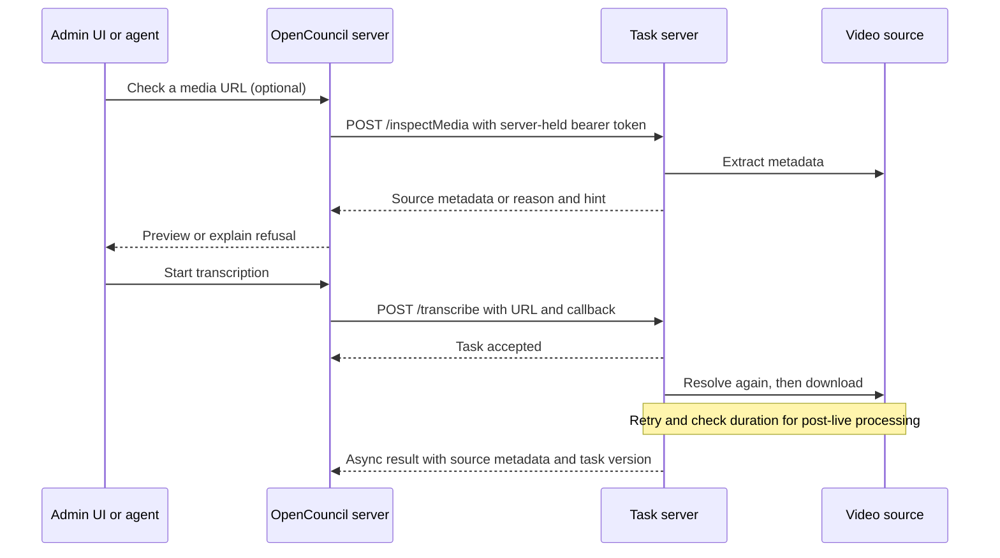

# Media inspection and downloads

The task server asks yt-dlp to resolve a URL rather than maintaining a list of supported
sites. A dedicated extractor or a known embedded player supplies the source identity;
a Generic direct file uses HTTP download. Spaces objects retain the existing storage path.
The URL supplied by the caller remains the download input, because replacing an embedding
page with its resolved video URL loses the referer that domain-restricted players require.

## Where inspection fits



Inspection is optional. Transcription performs its own lookup even if the app previously
inspected the URL: manifests, availability and duration can change after a live meeting.
The synchronous endpoint is not an asynchronous task and needs no task record or callback.
It can wait for an in-progress binary update. The lookup process has a timeout, but it is
not an end-to-end HTTP response deadline.

A successful inspection means metadata extraction succeeded. It is not a test of all media
fragments, the chosen download format, DRM discovered during transfer, or later availability.
Spaces inspection recognizes the URL without fetching the object. A source timestamp can
be its upload time or HTTP Last-Modified date; it must not automatically set a meeting date.

The OpenCouncil app already accepts HTTP(S) URLs and preserves the complete result JSON.
No app change is required for new sources to transcribe. The existing task submission
(`src/lib/tasks/transcribeInternal.ts` and `src/lib/tasks/tasks.ts` in the app) stays async.
To use inspection, add an authorized synchronous server-side client and a preview/check
action in the existing media form; keep the task API
key on the server. An MCP inspection tool can call the same client. If consuming `source`,
make it optional in the app type so old callbacks and replays remain valid. Automated
provider discovery is separate: the livestream poller still discovers YouTube videos.

Direct transfers publish their cache file only after the stream finishes. Cache keys for
new extractors also distinguish tenant origins and original ids, since page-generated ids
such as `index-1` are not unique across councils. Mutable content at the same URL can still
reuse the cached recording; replacing that recording requires clearing its cache.

## What using yt-dlp means

Supporting yt-dlp's extractor registry is different from exposing every yt-dlp option.
The configured binary's `--list-extractors` and `--help` show its current registry and options.
The server uses its existing quality/container policy, proxy configuration, and post-live
completeness checks. Generic HTML5 players, HLS and DASH should work through extraction.
Authentication cookies, passwords, explicit referers, browser impersonation and provider
extractor arguments require deliberate configuration and matching lookup/download behavior.
They are not available as arbitrary request arguments. The plain HTTP file path does not
inherit yt-dlp cookie/config-file authentication or its proxy; a protected file can resolve
metadata through yt-dlp and still fail its plain transfer. A site needing those features can
fail even though yt-dlp has an extractor for it. A DRM refusal is a failure, not a retry.

Whole-channel/playlist downloads and joining multiple videos remain outside the meeting
pipeline's single-video contract. A watch URL containing a playlist parameter still names
one video; a channel URL must not select an arbitrary meeting.

## Repeating verification

The raw downloader is the same path `/transcribe` uses, stopping before normalization,
audio extraction, uploads, Mux or transcription:

```sh
nix develop --command npm run build
nix develop --command npm run cli -- inspect-media 'https://example.org/meeting'
nix develop --command npm run cli -- download-ytv 'https://example.org/meeting' --download-only
```

The integration matrix pins a private copy of yt-dlp and records its version, then generates real media and serves it locally, testing inspection,
download duration, file size, cache reuse, interrupted-transfer recovery, refusal cases and the synchronous route. Remote
cases use real public URLs; their availability is not a stable unit-test contract. Samples
longer than ten minutes are inspected but skipped for full transfer. Other downloads are complete, and temporary media is removed after recording the report:

```sh
nix develop --command npx tsx scripts/verify-media-sources.ts --output /tmp/media-local.json
nix develop --command npx tsx scripts/verify-media-sources.ts --update-race --output /tmp/media-update.json
nix develop --command npx tsx scripts/verify-media-sources.ts \
  --remote scripts/fixtures/media-sources.json --output /tmp/media-expanded.json
```

Add new real sources to the JSON fixture rather than writing another probe. An inspection-only
case proves extraction, not downloading; use `download: true` to exercise full transfer and
cache reuse. Use `--only html5,hls` to repeat selected cases. `--update-race` uses a
deterministic updater fixture to prove that inspection waits for a running update.
`--update-timeout` additionally tests a stuck updater that ignores SIGTERM (takes a minute). This matrix does not exercise paid transcription services or claim to validate
every upstream extractor. Use the existing full smoke test for the rest of the pipeline.

A downloader may update the yt-dlp binary at runtime. The server guards its own lookups and
downloads against an in-process update. Separate CLI/server processes sharing a mutable
binary still need operational coordination; the verification matrix avoids this by using a
private copy with `YTDLP_AUTO_UPDATE=false`.
