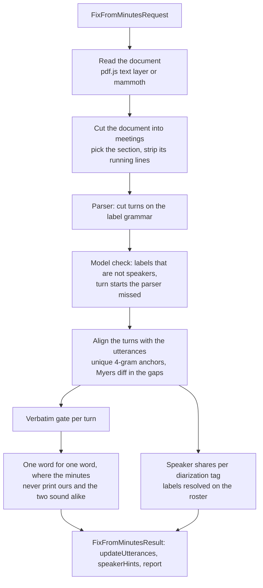

# Minutes correction (fixFromMinutes)

`fixFromMinutes` corrects a transcript from the municipality's own verbatim minutes (πρακτικά) and names the speakers from the labels of those minutes. It answers [schemalabz/opencouncil#876](https://github.com/schemalabz/opencouncil/issues/876): a past meeting has a recording and the municipality's minutes, but nobody to review the transcript.

The app calls it after `fixTranscript`, with the minutes URL, the meeting date and the session number on top of the usual transcript request. The result has the shape of a `fixTranscript` result plus a report. The contract is in `src/types.ts` (`FixFromMinutesRequest`, `FixFromMinutesResult`).

Task: `src/tasks/fixFromMinutes.ts`. Modules: `src/lib/municipalMinutes/`.

## What the task does



## Design decisions

**The text comes from the document, never from a model.** The minutes of one meeting reach 14 MB and 180 pages, past what a document block carries, and text extraction costs nothing. pdf.js is loaded when a PDF is read, not when the server starts: it pulls in a native canvas binding that costs 50 MB and prints warnings on an older Node. Its fake worker runs on the main thread, so the reader yields between pages.

**A letter-spaced document is decided for the whole document.** The PDF of Ρέθυμνο stores each word as one run with a space after each character («Π ρ ό ε δ ρ ο ς»). The reader measures the share of such runs in the whole document and, above 40%, joins the characters of each run. Ρέθυμνο measures 51% to 98% on its pages and the other documents 0% to 14%. The decision is not made per page: the spaced-out title on the cover of an ordinary document must not change how that page is read.

**The task refuses the minutes that OpenCouncil generated.** A municipality can publish the document that OpenCouncil exports from its own transcript. That document holds our text as it was on the day of the export. It has nothing to correct the transcript with, and it would put back a word that a reviewer corrected after that day. The reader fails with the reason when the cover holds the brand line and the address line of the export (`checkNotGenerated`).

**The document is cut into meetings before its running lines are stripped.** A document of several meetings repeats each meeting's title at the top of its own pages. Stripped first, the titles would go with the page numbers, and the whole document would become one section that matches any request. A cover page that states no session belongs to the meeting after it. The day of a date («της 20ης Οκτωβρίου») is not a session number, and a line of speech that names another session («η έγκριση των πρακτικών της 26ης συνεδρίασης») is not a title: a title has no verb, no particle and no speaker label.

**The label grammar comes from the documents of 19 municipalities, and a model checks it.** All but one print a turn as a label and a colon at the start of a line, with the speech on the same line or on the next line. A candidate label counts when it repeats, names a role, or names a person of the roster. A role word with a portfolio or a body after it («ΑΝΤΙΔΗΜΑΡΧΟΣ ΠΑΙΔΕΙΑΣ», «Πρόεδρος Δημοτικής Κοινότητας») is a role of its own: it resolves on a roster title that says the same, never on the bare role word, since the chair of a community is not the chair of the council. A role label keeps its parenthesis in its key: «ΑΝΤΙΔΗΜΑΡΧΟΣ (κ. Τράκας)» and «ΑΝΤΙΔΗΜΑΡΧΟΣ (κ. Πέτρου)» are two speakers. `parseLabel` is the one place that knows what a label is; the check's locator and the speaker resolution read its output.

Ρέθυμνο puts the whole label in a parenthesis: «(Πρόεδρος Δ.Σ., Λουκογεωργάκης Ευστάθιος):». The parser reads it as a role with a name. When the first part is not a role («(Εκπρόσωπος Κατοίκων, Μοάτσου Μαρία):»), the name alone is the label.

**Lines of the record follow the label grammar and are not turns.** The title block of many documents names the officers in the grammar of a label: «ΔΗΜΑΡΧΟΣ: ΜΠΑΜΠΑΛΟΣ ΝΙΚΟΛΑΟΣ», «ΠΡΟΕΔΡΟΣ: ΚΟΡΜΑ Δ. ΓΡΑΜΜΑΤΕΑΣ: ΚΕΦΑΛΑΣ ΕΥΑΓΓΕΛΟΣ». Such a line is a role and, after the colon, a name and nothing else. The fields of the title block come before the first turn: the first label with speech after it ends the title block, and a later line of the same shape is a turn (a secretary who calls a name). The headings of a vote, of the attendance and of a decision («ΥΠΕΡ (22)», «ΚΑΤΑ», «ΑΠΟΝΤΕΣ (13)», «Αρ. Απόφασης») repeat at each decision, and nobody speaks under them: they are never labels.

**The second label style has no colon, and the parser reads it only when the first style finds almost nothing.** Θεσσαλονίκη prints the label alone on a line, and the speech starts on the next line. Without a colon the label grammar alone accepts «Λοιπόν» and «Ναι». A bare line is therefore a label only when it names a role, a person of the roster, or a person of the document's own attendance list (three or more lines in a row that hold names and nothing else). A label has speech on both sides: a bare line next to another bare line is a list. The parser adds the bare labels only when it finds ten or more of them and more than twice the labels of the colon style.

The check (`claude-haiku-5-5`) reads the section in chunks with the parser's turn starts marked and answers two lists: labels that are not speakers, and turn starts the parser missed. Each answer is a label and the first words of the turn, never an offset: the code locates it in the text and drops what it cannot find. The model never returns speech, so the text stays as printed. The model sees the fields of the title block with no mark and can report them as missed turns. The code does not add such an answer: before the first label with speech after it, a line that holds a name and nothing else after its label is a field. As a turn it would run to the first speaker and count the cover, the attendance list and the agenda as speech. On the fixture of Ηλιούπολη that moved the coverage from 70.5% to 98.8%. A chunk whose call fails changes nothing in its range, and the report counts it. The check locates an added turn start by its colon, so it adds no label of the second style.

**Coverage measures what the parser could not read, not what is verbatim.** Every turn runs from its label to the next, so the share of the section's text inside turns is the share after the first label. A document whose labels the parser cannot read measures near zero and fails the floor. Summary minutes with labels pass it: their turns then fail the verbatim gate one by one, and the task writes nothing. The title block, the attendance list and the agenda lower the coverage of a verbatim document: one Πόρος document measures 84.5% because they are 15% of its 19 pages, which is why the floor is under the plan's 90%. The council minutes of the corpus below measure 91.1% to 99.9%. The committee documents that mix a few turns with the text of the decisions measure 59% and 67%, and the task refuses them.

**The alignment never matches out of order.** Unique 4-grams give anchors, the longest chain that increases on both sides is kept, and a Myers diff aligns the gaps. A gap too long for a diff is anchored again inside itself; what still holds no anchor stays unaligned, and so does a long gap whose two sides differ in length by more than a factor of three. A diff of such a gap pairs scattered common words, and every pair would bound a correction. Tokens compare in a folded form: no case, no accents, no punctuation, Latin homoglyphs folded, number words equal to digits, and the spellings a secretary and a transcriber choose differently equal to each other («κύριος» and «κ.», «κι» and «και», «τον» and «το»). The speaker shares count an utterance's words turn by turn, so an utterance that spans two turns counts in both.

**The minutes are an edited document, not a second transcript.** The secretary fixes grammar, swaps a word for a better one and corrects the roll call. The first rules took the minutes at their word and changed 5% of the words of a reviewed transcript; a phonetic rule brought that to 1.1%–1.4%, and still rewrote amounts («3.200.000» → «3.200»), flipped the roll call («Απούσα» → «παρούσα») and swapped «πλειοψηφίας» for «μειοψηφίας». Seven rules now separate a mishearing from an edit without reading either:

- One word for one word. A region where the word counts differ is a rewording, or a word pdf.js split in a justified line («είνα ι»).
- The minutes never print our word. A word the secretary uses elsewhere in the same minutes is a word they know and chose not to use here («πλειοψηφίας» against «μειοψηφίας», «να» against «θα»). A word they never print («Ρημάκης», «Μεσόγειον») is one the recogniser made up.
- The two words sound alike, and both are long enough to be misheard. A rewording («Ωραία» for «Λοιπόν») does not. A word of three sounds or fewer is never corrected, and it is never written as a correction: «η» and «οι» sound the same, and neither is a mishearing of the other. «πόσοι» and «πώς» differ by one sound and are two words.
- The digits are the same, whatever the letters do.
- The two words are not two written forms of one word. «δεχτώ» and «δεχθώ», «πληρώνουν» and «πληρώνουνε», «πέρυσι» and «πέρσι» are the same word in two registers, and the secretary's form is not more correct than ours. Such a pair is left as we wrote it, and it does not stop the other pairs of its region. On the two meetings that we read before their review, 40 of the 154 changed words were of this kind, and none of them moved an utterance closer to its reviewed text.
- The two words are not two inflections that sound the same. «συνεχίζεται» and «συνεχίζετε», «άδικοι» and «άδικη», «μνημειώδεις» and «μνημειώδης» are both words, and only the sentence says which one the speaker said. No rule here reads the sentence. The rule knows three pairs of endings: «-ται» and «-τε», «-οι» and «-η», «-είς» and «-ής». Such a pair is left as we wrote it, and it does not stop the other pairs of its region. On the two meetings that we read before their review, 15 of the 114 changed words were of this kind, and none of them moved an utterance closer to its reviewed text. The list holds no ending where one of the two forms is a spelling error («Μεσόγειον» and «Μεσογείων», «ομηρεία» and «ομηρία»): the next rule decides those.
- The two words are not two spellings of one sound, unless the minutes print a name or an acronym. The recogniser heard such a word right, so the pair is a question of spelling, and the secretary's spelling is not more correct than ours. Such a pair is left as we wrote it, and it does not stop the other pairs of its region. The minutes print an acronym when every letter of the word is a capital («ΚΗΦΙ» → «ΚΗΦΗ», «ΟΠΑΠ» → «ΟΠΠΑΠ»). They print a name when the word starts with a capital and does not start a sentence («Κουτουβήνη» → «Κουτουβίνη», «Αρμάω» → «Αρμάο», «Μεσόγειον» → «Μεσογείων»); a word after an abbreviation or an honorific does not start a sentence («κ. Κουτουβίνη»). A full stop that the document prints apart from its word («ψηφίζουμε . Διευκρινίσεις») ends the sentence all the same. The secretary knows the names of the people, the streets and the bodies of the municipality, and the recogniser writes them from their sound. A word of three sounds or fewer stays under the rule above. [The measurements below](#what-the-spelling-rule-measures) show what the rule keeps and what it loses.

Insertions and deletions are counted and never written. The utterance count and the timestamps never change. Our punctuation around a replaced span stays; an apostrophe belongs to its word. No model decides a correction.

**The speakers come from the shares, and the minutes never overwrite anyone.** For each diarization tag the task adds up the aligned words of its utterances by the label of the turn they fall in. The person with the largest share is the tag's `minutes` opinion, with the share as its purity. Labels resolve to people of the roster. A printed name wins: the name of a name label, or the name a role label's parenthesis gives («ΠΡΟΕΔΡΟΣ (κ. Μάγκος)» is the vice-chair in the chair's seat, not the chair). It goes through the name matcher of the decision reader, and then through its model matcher; a role label whose printed name both miss never falls back on the role. A role label without a name resolves through the roles the roster lists, in the body that is meeting first. A generic label («ΣΥΜΒΟΥΛΟΣ», «ΟΜΙΛΗΤΗΣ», «ΜΕΛΗ», «ΥΠ/ΚΟΣ ΠΑΡΑΓΩΝ») and a label that does not follow the grammar resolve to nobody without a model call: the model matcher is built for a surname. The result carries no `speakerHints` at all when the request has no roster or no speaker tags, so the app keeps what it has.

## The thresholds are starting values

Every threshold is a constant next to the code it governs, with the reason for its value in the comment: the coverage floor and the verbatim gate (`turns.ts`, `matching.ts`), the substitution length and the phonetic distance (`corrections.ts`), the purity floor and the aligned-words floor (`speakers.ts`). The values come from the first five documents and the first four reviewed meetings. The corpus and the three later meetings below played no part in choosing them, and no value changed after they were read. All the meetings with a transcript are from one municipality: the values need a second look on the meetings of another one, and the backtest below is how.

## Commands

```bash
# Cut a document into turns and print the labels, the coverage and what the model check changes.
npx tsx src/cli.ts minutes-turns <pdf, docx, url or paged .txt> [--check] [--date YYYY-MM-DD] [--session N] [--show 10] [-O turns.json]

# Run the task on reviewed meetings and score it against the reviewed transcript.
npx tsx src/cli.ts backtest-minutes-correction cityId/meetingId=<minutes url or file> ... [--no-check] [--input before.json] [-O results.json]
```

`minutes-turns` reads a local file or a URL. A `.txt` with «=== page N» lines between the pages is read as pages; the fixtures under `fixtures/municipal-minutes/` have this form.

`backtest-minutes-correction` fetches each meeting from opencouncil's public meeting endpoint. The public endpoint holds the reviewed text only. With `--input`, a JSON file of utterance id to text as `fixTranscript` left it, the command measures the word error rate before and after the task. Without it, the task runs on the reviewed text itself, and every change it makes is a disagreement with the reviewer to read one by one. The scorer folds case, accents and punctuation and nothing else: the task's own comparison form also equates spelling variants, and a wrong variant could never show as an error through it. The command prints, per meeting:

- the report fields: coverage, what the check changed and the chunks that failed, turns aligned and under the gate, utterances unmatched, substitutions and skipped insertions and deletions;
- the word error rate against the reviewed text, before and after;
- every changed utterance with its outcome: `fixed`, `closer`, `same`, `further`, or `broke` when the task changed a reviewed utterance;
- every speaker tag with an opinion, against the person of the reviewed record.

## What the documents measure

The parser reads the verbatim council minutes of 19 municipalities with no per-municipality configuration. One fixture per municipality is under `fixtures/municipal-minutes/`, and `turns.test.ts` states the labels and the coverage of each one.

### The first five documents, with the check

The parser and the check were run on the verbatim minutes of five municipalities (see the plan on the issue). The check adds the turns of speakers the parser saw once and the roster did not know, among them the secretary's misspellings of a surname («ΛΙΛΙΤΣΗΣ» for «ΛΙΛΤΣΗΣ»), and removes the two «ΜΕΙΟΝ» rows of a budget table in Καλαμαριά and the attendance line «Πρόεδρος ΔΣ Νέων: Αρμάος Μιχάλης» in Παπάγου. These values are from before the title-block rule. With it the parser itself leaves that attendance line out, the fields of a title block are no longer turns, and the turn counts of the documents that have a title block are lower by a few turns.

| Document | Pages | Parser turns | Coverage | Check added / removed / dropped | Check input tokens |
|---|---|---|---|---|---|
| Νέα Φιλαδέλφεια 27η, 20/10/2025 | 111 | 962 | 99.8% | 1 / 0 / 0 | 162K |
| Παπάγου-Χολαργός 20η, 07/10/2026 | 25 | 191 | 99.6% | 11 / 1 / 0 | 50K |
| Πόρος 12η, 17/03/2025 | 19 | 89 | 84.5% | 3 / 0 / 0 | 14K |
| Καλαμαριά 16η, 24/07/2017 | 180 | 548 | 98.2% | 5 / 2 / 0 | 398K |
| Παύλος Μελάς 1ο, 27/01/2021 | 44 | 638 | 95.0% | 9 / 0 / 0 | 112K |

### The corpus, parser only

The second set is the minutes that 16 municipalities publish on their own sites, read by the current parser with no roster and no check. A roster and the check add turns, so the task itself measures the same or more.

| Municipality | Document | Pages | Parser turns | Coverage |
|---|---|---|---|---|
| Δράμα | ΔΣ 32η, 21/10/2026 | 172 | 434 | 99.0% |
| Ελληνικό-Αργυρούπολη | ΔΣ 34η, 30/09/2026 | 72 | 497 | 97.8% |
| Επίδαυρος | ΔΣ 1η, 26/01/2021 | 66 | 345 | 99.8% |
| Ηλιούπολη | ΔΣ 15η, 19/06/2026 | 73 | 199 | 97.9% |
| Ηράκλειο Αττικής | ΔΣ 18η, 07/10/2026 | 161 | 179 | 98.1% |
| Θεσσαλονίκη | ΔΣ 19η, 31/08/2026 | 117 | 764 | 99.6% |
| Θεσσαλονίκη | ΔΣ 20ή, 21/09/2026 | 105 | 863 | 99.5% |
| Ίλιον | ΔΣ of 01/10/2026 | 59 | 106 | 96.2% |
| Κάλυμνος | ΔΣ 12η, 03/07/2026 | 23 | 122 | 94.5% |
| Κατερίνη | ΔΣ 40ή, 12/10/2026 | 29 | 109 | 92.2% |
| Μακρακώμη | ΔΣ, 2017 | 9 | 91 | 99.9% |
| Παπάγου-Χολαργός | ΔΣ 14η to 23η of 2026, ten documents | 13 to 88 | 34 to 465 | 94.0% to 99.6% |
| Πέραμα | ΔΣ 20ή, 14/10/2026 | 125 | 848 | 97.8% |
| Πέραμα | ΔΕ 25η, 14/09/2026 | 41 | 198 | 99.4% |
| Πόρος | ΔΣ 12η, 30/06/2026 | 35 | 248 | 91.1% |
| Πόρος | ΔΣ 13η of 2026 | 24 | 55 | 92.5% |
| Ρέθυμνο | ΔΣ 27η of 2026 | 151 | 760 | 96.1% |
| Σέρρες | ΔΣ 3η of 2020 | 230 | 837 | 98.8% |
| Ωρωπός | ΔΣ 15η, 05/07/2026 | 14 | 33 | 98.1% |

Documents of the same search that the task does not correct from:

- Scans with no text layer (Πόρος 14η to 16η, Ραφήνα-Πικέρμι, Περιφέρεια Αττικής). The reader fails with the reason.
- Committee documents that are decisions with a few turns (Ηράκλειο Αττικής ΔΕ 67.4%, Κατερίνη ΔΕ 59.0%) and the decision tables of the Παπάγου-Χολαργός committee (no turn). They fail the coverage floor.
- Ρόδος, two committee documents of 2015: a DOCX at 74.3% and a PDF whose font encoding gives wrong letters, at 57.8%. They fail the coverage floor.
- The summary minutes of Αθήνα («πρόχειρα πρακτικά»): six turns at 93.6%. The coverage floor passes them, and the verbatim gate is the guard. No transcript was at hand to measure the gate on them.
- The exports of the OpenCouncil transcript. `checkNotGenerated` refuses the two Ζωγράφου samples. The three Ξυλόκαστρο-Ευρωστίνη documents have a different cover and pass that guard; they print no speaker label, and they fail the coverage floor with no turn.

Known limits of the parser on this corpus:

- A document that states no session number has no identity (Ίλιον, Μακρακώμη). It is read as one section that matches any request.
- A last page that quotes another session becomes a section of its own (Ηράκλειο Αττικής, Θεσσαλονίκη 19η). The request's date and session still pick the right section.
- The first label of Πέραμα, «ΠΡΟΕΔΡΟΣ: (Πενταρβάνης Κωνσταντίνος):», leaves the name at the start of the turn's text.
- A first turn that has the shape of a title field (a role, then two or more capitalised words with no sentence punctuation) is read as the title block and is outside the turns.
- In the second label style, a first name of the attendance list that stands alone on a line with speech on both sides is read as a label.

The task calls the model for the check and for the names the rules do not settle. On the seven meetings below the check reads 26K to 181K input tokens per meeting; the 180-page document reads 398K. At Haiku prices that is under one cent for a short meeting, about two cents for an 88-page document and about five cents for the 180-page one.

## What the seven reviewed meetings measure

The backtest ran on the seven Παπάγου-Χολαργός council sessions of 2026 that have a reviewed transcript on the platform and published minutes (17η to 23η), on the reviewed text, with the model check on. Every change is therefore a disagreement with the reviewer. On these seven the check adds two turn starts and removes one label. The check is a model, and the counts move between runs: two earlier runs added two and six, and removed nine and four.

| Meeting | Utterances | Turns aligned | Under the gate | Substitutions | Changed utterances | Words changed |
|---|---|---|---|---|---|---|
| 17η (aug31_2_2026) | 1,046 | 217/230 | 8 | 36 | 32 | 0.3% |
| 18η (sep29_2_2026) | 639 | 123/129 | 1 | 15 | 15 | 0.2% |
| 19η (sep29_3_2026) | 2,349 | 457/477 | 32 | 32 | 31 | 0.1% |
| 20η (oct7_2026) | 862 | 189/197 | 10 | 17 | 16 | 0.2% |
| 21η (oct13_(2)_2026) | 427 | 143/150 | 5 | 3 | 3 | 0.1% |
| 22η (oct20_2026) | 3,275 | 369/395 | 26 | 43 | 43 | 0.1% |
| 23η (oct29_2026) | 1,140 | 159/171 | 13 | 21 | 20 | 0.1% |

The seven meetings hold 103,504 words, and the task changes 167 of them. Before the rule on the two written forms of one word the same run changed 338. Before the rule on the two inflections that sound the same it changed 243. Before the rule on the two spellings of one sound it changed 218. Before the test on the short word read both words of a pair it changed 170: the three pairs were «όλον» → «όλο», «17η» → «17ης» and «εμάς» → «μας».

No change alters a digit or the number of words of an utterance. By a reading of the changed word pairs:

- 16 pairs sound the same, sound for sound, and the minutes print each of them as a name: streets and places («Μεσόγειον» → «Μεσογείων», «Θουκιδίδου» → «Θουκυδίδου», «Φανερομένης» → «Φανερωμένης») and surnames («Παπακυρίλου» → «Παπακυρίλλου», «Φιλιπακόπουλος» → «Φιλιππακόπουλος»). The rule on the two spellings of one sound removed 48 more pairs. 21 of them were spellings that the minutes have right and the reviewed transcript has wrong («διευκρινήσεις» → «διευκρινίσεις», «απορρίματα» → «απορρίμματα», «εξώδους» → «εξόδους», «υποθεί» → «ειπωθεί»). 24 were pairs where both forms are in use, or where only the sentence decides («βρώμα» and «βρόμα», «κολόνα» and «κολώνα», «υποβάλει» and «υποβάλλει»). 3 were errors of the minutes («ποικίλλει» → «ποικίλει», «Ενεχυριάσατε» → «ενεχειριάσατε»). The pairs of two inflections that sound the same («αναφέρετε» and «αναφέρεται», «άδικοι» and «άδικη») were 26 of the 243 changed words, and the task does not write them either.
- About 150 pairs sound alike and not the same. They hold the mishearings that the minutes fix and the reviewer left («Χατζηχρόνου» → «Χατζηχρόνογλου», «βραχυτόνας» → «βραχυχίτωνας», «διαπερής» → «διαμπερής», «εξομοιώσεις» → «αυξομειώσεις», «Πλέσσα» → «Μπλέσσα»), the secretary's grammar and register («κάναμε» → «κάνουμε», «ξεκινούν» → «ξεκινάνε», «καινούριο» → «καινούργιο»), and the errors that the task copies from the minutes («αντιμετωπίσεις» → «αντιμεπωπίσεις», «χρήστης» → «χρήσης», «κράνος» → «κράτος»).

The rules cannot tell the errors of the minutes from the mishearings: a word the minutes print and the transcript does not is trusted when it sounds alike.

Speakers: 73 actionable opinions on the seven meetings, 72 agree with the reviewed record. The one that disagrees is on the 19η, SPEAKER_14: the record names Μαρία Αθανασάκου-Μουντάκη, and the minutes label 96% of the tag's aligned words «ΣΟΥΡΑΝΗ». In production it is a disagreement between methods: nobody is assigned and the report names the tag.

## What the two meetings measure before their review

The 22η and the 23η were also read before the review ended. The `--input` file holds the text of the utterances that a person edited later, as `fixTranscript` left it; the other utterances have the reviewed text on both sides. A change to an utterance that the reviewer left alone therefore scores as `broke`, also when the change is a correct spelling.

| Meeting | Substitutions | Changed utterances | Fixed | Same | Further | Broke | Word error rate before → after | Speakers right |
|---|---|---|---|---|---|---|---|---|
| 22η (oct20_2026) | 45 | 45 | 5 | 0 | 1 | 39 | 0.6% → 0.7% (225 → 260 of 35,749) | 17 of 17 |
| 23η (oct29_2026) | 26 | 24 | 4 | 2 | 1 | 17 | 1.0% → 1.1% (147 → 161 of 14,265) | 9 of 9 |

After `fixTranscript`, about 1% of the words differ from the reviewed text. The task brings nine utterances to their reviewed text and moves two away from it. The other changes are in utterances that the reviewer did not edit; they are the kinds of pair that the reading above lists. The speakers are the reliable part: every actionable opinion on the two meetings agrees with the record that the reviewer made later.

Limits: all nine meetings with a reviewed transcript are from one municipality, and seven of the nine runs are on the reviewed text. The word corrections after `fixTranscript` are a small gain with a cost: the task fixes a part of what the reviewer would fix, and it also copies the secretary's choices and errors. The rule on the two inflections that sound the same removed 15 such changes on the two meetings. The rule on the two spellings of one sound removed 28 more: the fixed utterances stayed nine, and the `broke` utterances went from 83 to 56. The word error rate after the task stays above the rate before it.

## What three more municipalities measure

Three council meetings of other municipalities ran on a preview from the recording to the summary: `transcribe`, `fixTranscript`, `fixFromMinutes` and `summarize`. The first run used the task before the rule on the two spellings of one sound. The second run used the seven rules of this document. None of the three has a reviewed transcript, so no word error rate exists for them.

| Meeting | Coverage | Turns aligned | Words | Changed words, first run → second run | Speakers: actionable / contested / disagreements |
|---|---|---|---|---|---|
| Πέραμα 20η, 14/10/2026 | 97.8% | 787/857 | 22,411 | 90 → 71 | 16 / 3 / 0 |
| Ίλιον 17η, 01/10/2026 | 96.2% | 103/114 | 13,503 | 42 → 30 | 11 / 1 / 0 |
| Κατερίνη 40η, 12/10/2026 | 92.2% | 258/283 | 11,530 | 67 → 57 | 11 / 3 / 0 |

Every actionable opinion names the person of its label. Πέραμα has a mayor «Λαγουδάκος» and a councillor «Λαγουδάκης», and the task keeps them apart. The labels that resolve to nobody are guests, employees and generic labels («ΟΜΙΛΗΤΗΣ», «Υπάλληλος»).

The pairs of another sound hold the corrections of names and terms («Κουτουβής» → «Κουτουβίνης», «Μπαμπάζογλου» → «Παπάζογλου», «Χωρινό» → «Κορινό», «παραλογικότητα» → «παραγωγικότητα», «ανάλογος» → «ανάδοχος») next to the secretary's register («ακόμη» → «ακόμα», «επταμελής» → «εφταμελής»).

### What the spelling rule measures

46 of the 199 changed words of the three meetings are another spelling of the same sound. The minutes print 11 of them as a name or an acronym, and the rule keeps those. By a reading, 7 are corrections («ΚΗΦΙ» → «ΚΗΦΗ», «ΟΠΑΠ» → «ΟΠΠΑΠ», «Κουτουβήνη» → «Κουτουβίνη»), 2 are errors of the minutes («Άδωνι» → «Άδωνη», «Νεωτέρων» → «Νεοτέρων») and 2 have no source to check («Κολιβά» → «Κολυβά», «Κόσιβας» → «Κόσσιβας»).

The rule leaves the other 35 as we wrote them, and the three meetings then have 164 changed words. Six more pairs have one word of three sounds or fewer, and the task does not write them either: a change of meaning («πόσοι» → «πώς»), a correction that is lost («ΚΑΠ» → «ΚΔΑΠ»), «2FA» → «2MFA» and three times «άλλον» → «άλλο». That leaves 158 changed words. By the same reading of the 35:

| Removed pairs | Errors of the minutes | Both forms in use, or the sentence decides | Corrections that are lost |
|---|---|---|---|
| Πέραμα, Ίλιον, Κατερίνη (35) | 17: «περαιτέρω» → «περεταίρω», «ελλείμματος» → «ελλείματος», «κοινωφελή» → «κοινοφελή», «παραληφθεί» → «παραλειφθεί» | 16: «ταμειακό» → «ταμιακό», «κτήρια» → «κτίρια» | 2: «αύλιου» → «αύλειου» |
| Παπάγου-Χολαργός, seven reviewed meetings (48) | 3 | 24 | 21: «απορρίματα» → «απορρίμματα», «εξώδους» → «εξόδους» |

The two rows show the limit of the rule. One secretary spells better than the recogniser and another does not, and a rule that does not read the word cannot tell them apart. The rule gives up about three spelling corrections for each meeting of Παπάγου-Χολαργός, and it stops about eleven wrong or needless changes for each meeting of the other three. The reviewed text cannot score this choice: the reviewer does not correct spelling («απορρίματα» and «εξώδους» are in the reviewed text), so a correct spelling scores as `broke`.

The figures of the three municipalities come from two runs on the preview. The first run used the task before the spelling rule, and its changed utterances were read pair by pair. The second run used the seven rules and the test on the short word, on the text from before the first run. It changes 158 words (Πέραμα 71, Ίλιον 30, Κατερίνη 57) and writes no pair that the first run did not write. The coverage, the aligned turns and the speaker opinions are the same in the two runs. The reading had counted 36 removed pairs and 157 words: it read «Κόσιβας» → «Κόσσιβας» as the start of a sentence, because the word starts our utterance. The rule reads the word before it in the minutes, and it keeps the pair. On the nine Παπάγου-Χολαργός runs the same reading and a run with the rule give the same pairs.

## Not in this version

Scanned minutes (OCR), meetings without a recording, inserting text our pipeline lost (counted as insertions), splitting a diarization tag that the minutes give to two people, a model arbiter for the contested spans, a spelling word list for the pairs that sound the same, and a DOCX that holds several meetings: a DOCX has no pages, so it is read as one section. With a word list the task would keep a spelling of one sound when only the minutes' form is a known word: on the data above this keeps 15 more pairs, all of them corrections by a reading.
