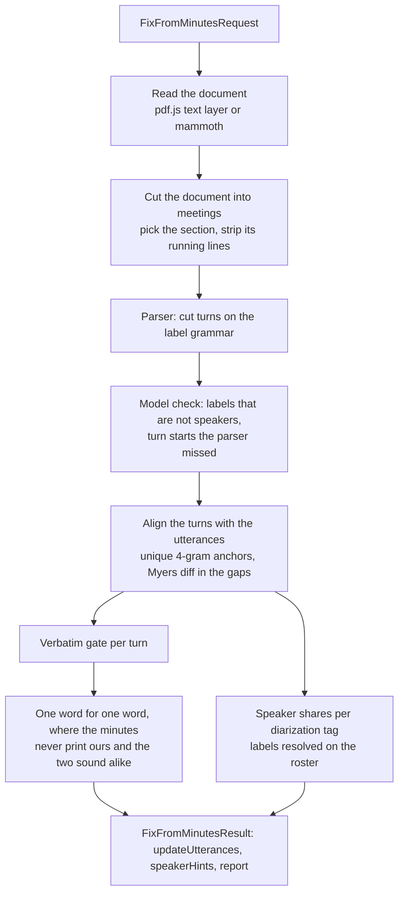

# Minutes correction (fixFromMinutes)

`fixFromMinutes` corrects a transcript from the municipality's own verbatim minutes (πρακτικά) and names the speakers from the labels of those minutes. It answers [schemalabz/opencouncil#876](https://github.com/schemalabz/opencouncil/issues/876): a past meeting has a recording and the municipality's minutes, but nobody to review the transcript.

The app calls it after `fixTranscript`, with the minutes URL, the meeting date and the session number on top of the usual transcript request. The result has the shape of a `fixTranscript` result plus a report. The contract is in `src/types.ts` (`FixFromMinutesRequest`, `FixFromMinutesResult`).

Task: `src/tasks/fixFromMinutes.ts`. Modules: `src/lib/municipalMinutes/`.

## What the task does



## Design decisions

**The text comes from the document, never from a model.** The minutes of one meeting reach 14 MB and 180 pages, past what a document block carries, and text extraction costs nothing. pdf.js is loaded when a PDF is read, not when the server starts: it pulls in a native canvas binding that costs 50 MB and prints warnings on an older Node. Its fake worker runs on the main thread, so the reader yields between pages.

**The document is cut into meetings before its running lines are stripped.** A document of several meetings repeats each meeting's title at the top of its own pages. Stripped first, the titles would go with the page numbers, and the whole document would become one section that matches any request. A cover page that states no session belongs to the meeting after it. The day of a date («της 20ης Οκτωβρίου») is not a session number, and a line of speech that names another session («η έγκριση των πρακτικών της 26ης συνεδρίασης») is not a title: a title has no verb, no particle and no speaker label.

**The label grammar is a guess from five documents, and a model checks it.** All five print a turn as a label and a colon at the start of a line. A candidate label counts when it repeats, names a role, or names a person of the roster. A role word with a portfolio or a body after it («ΑΝΤΙΔΗΜΑΡΧΟΣ ΠΑΙΔΕΙΑΣ», «Πρόεδρος Δημοτικής Κοινότητας») is a role of its own: it resolves on a roster title that says the same, never on the bare role word, since the chair of a community is not the chair of the council. A role label keeps its parenthesis in its key: «ΑΝΤΙΔΗΜΑΡΧΟΣ (κ. Τράκας)» and «ΑΝΤΙΔΗΜΑΡΧΟΣ (κ. Πέτρου)» are two speakers. `parseLabel` is the one place that knows what a label is; the check's locator and the speaker resolution read its output.

The check (`claude-haiku-5-5`) reads the section in chunks with the parser's turn starts marked and answers two lists: labels that are not speakers, and turn starts the parser missed. Each answer is a label and the first words of the turn, never an offset: the code locates it in the text and drops what it cannot find. The model never returns speech, so the text stays as printed. A chunk whose call fails changes nothing in its range, and the report counts it.

**Coverage measures what the parser could not read, not what is verbatim.** Every turn runs from its label to the next, so the share of the section's text inside turns is the share after the first label. A document whose labels the parser cannot read measures near zero and fails the floor. Summary minutes with labels pass it: their turns then fail the verbatim gate one by one, and the task writes nothing. The attendance list and the agenda lower the coverage of a verbatim document: Πόρος measures 84.5% because they are 15% of a 19-page document, which is why the floor is under the plan's 90%.

**The alignment never matches out of order.** Unique 4-grams give anchors, the longest chain that increases on both sides is kept, and a Myers diff aligns the gaps. A gap too long for a diff is anchored again inside itself; what still holds no anchor stays unaligned, and so does a long gap whose two sides differ in length by more than a factor of three. A diff of such a gap pairs scattered common words, and every pair would bound a correction. Tokens compare in a folded form: no case, no accents, no punctuation, Latin homoglyphs folded, number words equal to digits, and the spellings a secretary and a transcriber choose differently equal to each other («κύριος» and «κ.», «κι» and «και», «τον» and «το»). The speaker shares count an utterance's words turn by turn, so an utterance that spans two turns counts in both.

**The minutes are an edited document, not a second transcript.** The secretary fixes grammar, swaps a word for a better one and corrects the roll call. The first rules took the minutes at their word and changed 5% of the words of a reviewed transcript; a phonetic rule brought that to 1.1%–1.4%, and still rewrote amounts («3.200.000» → «3.200»), flipped the roll call («Απούσα» → «παρούσα») and swapped «πλειοψηφίας» for «μειοψηφίας». Four rules now separate a mishearing from an edit without reading either:

- One word for one word. A region where the word counts differ is a rewording, or a word pdf.js split in a justified line («είνα ι»).
- The minutes never print our word. A word the secretary uses elsewhere in the same minutes is a word they know and chose not to use here («πλειοψηφίας» against «μειοψηφίας», «να» against «θα»). A word they never print («Ρημάκης», «Μεσόγειον») is one the recogniser made up.
- The two words sound alike, and both are long enough to be misheard. A rewording («Ωραία» for «Λοιπόν») does not. A word of three sounds or fewer is never corrected: «η» and «οι» sound the same, and neither is a mishearing of the other.
- The digits are the same, whatever the letters do.

Insertions and deletions are counted and never written. The utterance count and the timestamps never change. Our punctuation around a replaced span stays; an apostrophe belongs to its word. No model decides a correction.

**The speakers come from the shares, and the minutes never overwrite anyone.** For each diarization tag the task adds up the aligned words of its utterances by the label of the turn they fall in. The person with the largest share is the tag's `minutes` opinion, with the share as its purity. Labels resolve to people of the roster. A printed name wins: the name of a name label, or the name a role label's parenthesis gives («ΠΡΟΕΔΡΟΣ (κ. Μάγκος)» is the vice-chair in the chair's seat, not the chair). It goes through the name matcher of the decision reader, and then through its model matcher; a role label whose printed name both miss never falls back on the role. A role label without a name resolves through the roles the roster lists, in the body that is meeting first. A generic label («ΣΥΜΒΟΥΛΟΣ», «ΟΜΙΛΗΤΗΣ», «ΜΕΛΗ», «ΥΠ/ΚΟΣ ΠΑΡΑΓΩΝ») and a label that does not follow the grammar resolve to nobody without a model call: the model matcher is built for a surname. The result carries no `speakerHints` at all when the request has no roster or no speaker tags, so the app keeps what it has.

## The thresholds are starting values

Every threshold is a constant next to the code it governs, with the reason for its value in the comment: the coverage floor and the verbatim gate (`turns.ts`, `matching.ts`), the substitution length and the phonetic distance (`corrections.ts`), the purity floor and the aligned-words floor (`speakers.ts`). The values come from the five documents and the four reviewed meetings below. They need a second look on meetings that played no part in choosing them, and the backtest below is how.

## Commands

```bash
# Cut a document into turns and print the labels, the coverage and what the model check changes.
npx tsx src/cli.ts minutes-turns <pdf, docx, url or paged .txt> [--check] [--date YYYY-MM-DD] [--session N] [--show 10] [-O turns.json]

# Run the task on reviewed meetings and score it against the reviewed transcript.
npx tsx src/cli.ts backtest-minutes-correction cityId/meetingId=<minutes url or file> ... [--no-check] [--input before.json] [-O results.json]
```

`minutes-turns` reads a local file or a URL. A `.txt` with «=== page N» lines between the pages is read as pages; the fixtures under `fixtures/municipal-minutes/` have this form.

`backtest-minutes-correction` fetches each meeting from opencouncil's public meeting endpoint. The public endpoint holds the reviewed text only. With `--input`, a JSON file of utterance id to text as `fixTranscript` left it, the command measures the word error rate before and after the task. Without it, the task runs on the reviewed text itself, and every change it makes is a disagreement with the reviewer to read one by one. The scorer folds case, accents and punctuation and nothing else: the task's own comparison form also equates spelling variants, and a wrong variant could never show as an error through it. The command prints, per meeting:

- the report fields: coverage, what the check changed and the chunks that failed, turns aligned and under the gate, utterances unmatched, substitutions and skipped insertions and deletions;
- the word error rate against the reviewed text, before and after;
- every changed utterance with its outcome: `fixed`, `closer`, `same`, `further`, or `broke` when the task changed a reviewed utterance;
- every speaker tag with an opinion, against the person of the reviewed record.

## What the five documents measure

The parser and the check were run on the verbatim minutes of five municipalities (see the plan on the issue). All five parse with no per-municipality configuration. The check adds the turns of speakers the parser saw once and the roster did not know, among them the secretary's misspellings of a surname («ΛΙΛΙΤΣΗΣ» for «ΛΙΛΤΣΗΣ»), and removes the two «ΜΕΙΟΝ» rows of a budget table in Καλαμαριά and the attendance line «Πρόεδρος ΔΣ Νέων: Αρμάος Μιχάλης» in Παπάγου.

| Document | Pages | Parser turns | Coverage | Check added / removed / dropped | Check input tokens |
|---|---|---|---|---|---|
| Νέα Φιλαδέλφεια 27η, 20/10/2025 | 111 | 962 | 99.8% | 1 / 0 / 0 | 162K |
| Παπάγου-Χολαργός 20η, 07/10/2026 | 25 | 191 | 99.6% | 11 / 1 / 0 | 50K |
| Πόρος 12η, 17/03/2025 | 19 | 89 | 84.5% | 3 / 0 / 0 | 14K |
| Καλαμαριά 16η, 24/07/2017 | 180 | 548 | 98.2% | 5 / 2 / 0 | 398K |
| Παύλος Μελάς 1ο, 27/01/2021 | 44 | 638 | 95.0% | 9 / 0 / 0 | 112K |

The task calls the model for the check and for the names the rules do not settle. On the four meetings below the check reads 39K to 126K input tokens per meeting; the 180-page document reads 398K. At Haiku prices that is under one cent for a normal meeting and about five cents for the long document.

## What the four reviewed meetings measure

The backtest ran on the four Παπάγου-Χολαργός council sessions of 2026 that have a reviewed transcript on the platform and published minutes (17η, 18η, 19η, 20η), on the reviewed text, with the model check on. Every change is therefore a disagreement with the reviewer. On these four the check adds no turn start and removes one label; the parser accepts the labels it added in earlier runs.

| Meeting | Utterances | Turns aligned | Under the gate | Substitutions | Changed utterances | Words changed |
|---|---|---|---|---|---|---|
| 17η (aug31_2_2026) | 1,046 | 217/232 | 8 | 55 | 49 | 0.5% |
| 18η (sep29_2_2026) | 639 | 124/133 | 2 | 24 | 24 | 0.4% |
| 19η (sep29_3_2026) | 2,349 | 457/482 | 32 | 72 | 67 | 0.3% |
| 20η (oct7_2026) | 862 | 189/202 | 10 | 26 | 25 | 0.3% |

No change alters a digit or the number of words of an utterance. By a reading of the 98 word pairs the four meetings change, about half are spellings where both forms are in use («επισκέφτηκα» and «επισκέφθηκα», «ψήφισαν» and «ψηφίσανε»), about a quarter are the secretary's grammar («καταθέτουμε» → «καταθέσουμε», «φέρατε» → «φέρνετε»), about a quarter are mishearings the minutes fix («Μεσόγειον» → «Μεσογείων», «Θουκιδίδου» → «Θουκυδίδου», «διαπερής» → «διαμπερής», «Θέτω» → «Θέλω»), and six copy an error of the minutes («αντιμετωπίσεις» → «αντιμεπωπίσεις», «χρήστης» → «χρήσης»). The rules cannot tell the last kind from the third: a word the minutes print and the transcript does not is trusted when it sounds alike.

Speakers: 38 actionable opinions on the four meetings, 37 agree with the reviewed record. The one that disagrees is on the 19η, SPEAKER_14: the record names Μαρία Αθανασάκου-Μουντάκη, and the minutes label 96% of the tag's aligned words «ΣΟΥΡΑΝΗ». In production it is a disagreement between methods: nobody is assigned and the report names the tag. Every other opinion, actionable or not, agrees with the record except four on tags with one to five aligned words.

Limits: four meetings from one municipality, scored on the reviewed text without the text as `fixTranscript` left it. The word error rate before and after the task needs `--input`.

## Not in this version

Scanned minutes (OCR), meetings without a recording, inserting text our pipeline lost (counted as insertions), splitting a diarization tag that the minutes give to two people, a model arbiter for the contested spans, and a DOCX that holds several meetings: a DOCX has no pages, so it is read as one section.
